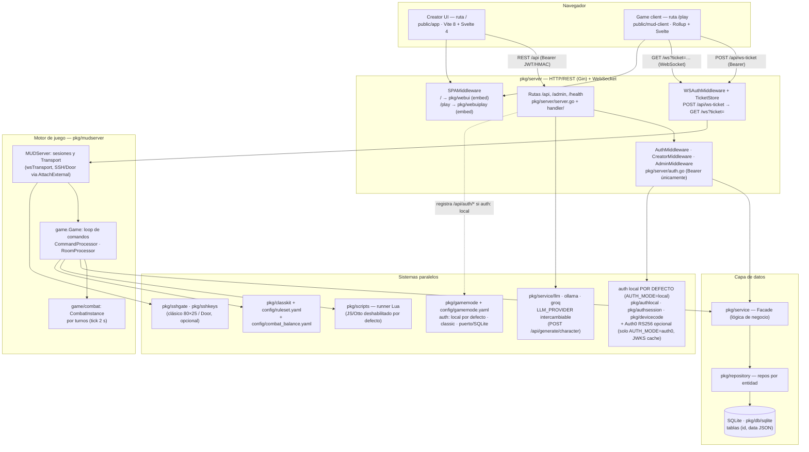
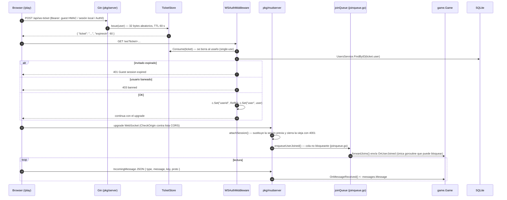
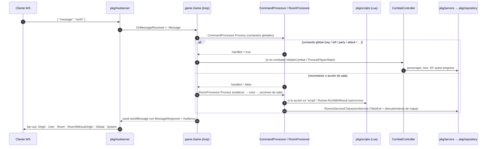
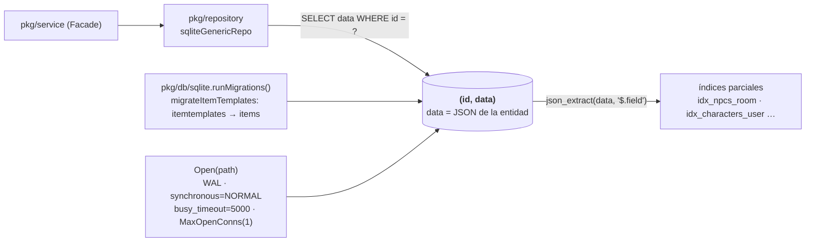
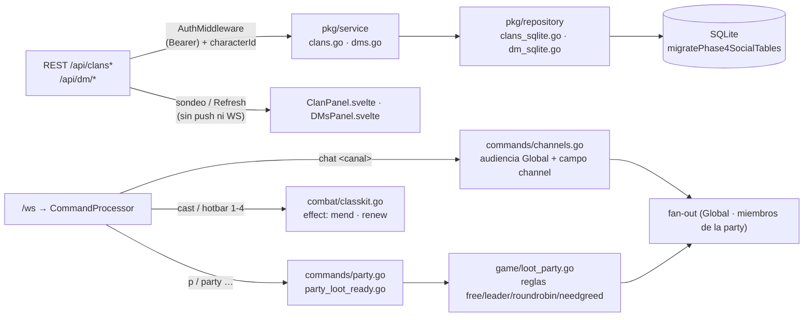
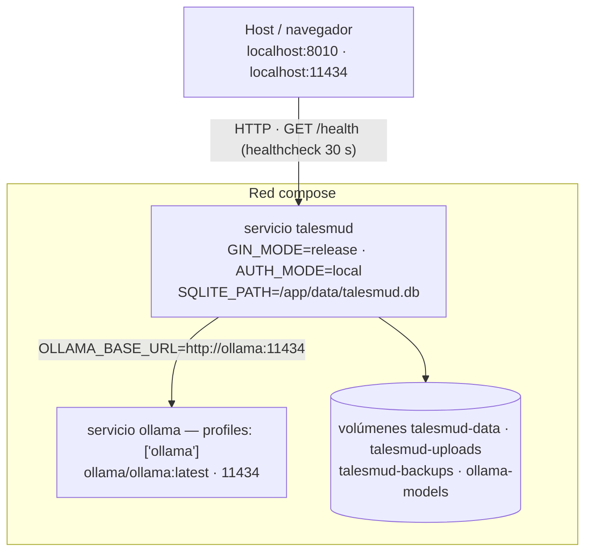

# Arquitectura del fork `mi-mud`

> **Alcance de este documento:** describe la arquitectura del **fork**, no la del
> motor upstream. El detalle genérico de TalesMUD v0.5.0 vive en
> [`ARCHITECTURE.md`](../ARCHITECTURE.md) (raíz), [`PROJECT.md`](../PROJECT.md) y
> [`FEATURES.md`](../FEATURES.md); este archivo se centra en lo que el fork
> **usa, conecta y va a cambiar**. La guía de arranque está en
> [`docs/fork-setup.md`](fork-setup.md).

---

## 1. Visión general y propósito

El fork parte de **TalesMUD v0.5.0** (framework MUD web en Go + Svelte) y lo
convierte en un **dungeon-crawler web persistente** con estas prioridades de
producto:

| Pilar | Qué implica en la arquitectura |
|---|---|
| **Dungeon-crawler** | Mazmorras como contenido de un *world pack*; instancias privadas por personaje (`type: instance`, `tales.instances.generate`), combate por turnos aislado por `CombatInstance`, loot y progresión. |
| **Clases mágicas** | Catálogo de clases en memoria (`pkg/classkit`) cargado desde el pack del mundo, con escuelas de magia, hotbar de habilidades, maná y balance por clase (`config/combat_balance.yaml`). |
| **Clanes** | Sistema **nuevo, ya implementado**: entidad + repositorios SQLite (`clans`, `clan_members`, `clan_invites`, `clan_bank_ledger`), facade de servicio, **API REST** bajo `/api/clans*` y panel de juego (`ClanPanel.svelte`, tecla `C`). No existe en v0.5.0; el motor solo trae fiestas efímeras (`party`) y lista de amigos (`friend`). **Todavía no hay comandos `clan …` ni canal de chat de clan.** Guía: [`docs/user/clans.md`](user/clans.md). |
| **Mensajería privada** | Upstream trae `tell`/`whisper` (`pkg/mudserver/game/commands/tell.go`), `friend`, chat de fiesta y fan-out por audiencias. El fork **añade DMs persistentes por personaje** (`dm_channels` + `dm_messages`, API `/api/dm/*`, panel con no leídos, sondeo 5 s) y **canales globales** (`chat general\|trade\|lfg\|help\|roleplay\|admin`). Guías: [`dms.md`](user/dms.md), [`channels.md`](user/channels.md). |
| **DMs = direct messages vs. Dungeon Master** | **Atención a la ambigüedad de nombre.** En este fork **DMs = mensajería privada** (fila anterior, implementada). El plan de producto de **Dungeon Master** como rol persistente del personaje (permisos de dirección de mazmorra y eventos en vivo) sigue **pendiente**; upstream solo tiene roles Admin/Creator y herramientas live-ops (`/api/live/*`, `/api/ops/:action`, audit + undo) ligadas al usuario, no al personaje. |
| **LLM local (Ollama)** | Proveedor local por defecto (`pkg/service/ollama`) detrás del contrato `llm.Client` (`pkg/service/llm`), con Groq hospedado como alternativa. El objetivo es que la generación de personaje y, más adelante, diálogos/descripciones corran sin API key. |

Todo el contenido del mundo (salas, NPCs, mazmorras, clases, scripts) llega
**importado desde un pack** (`import/<pack>/…`, `./bin/tales -import <pack>`); el
repositorio del fork no versiona contenido, solo el motor
(ver [`import/README.md`](../import/README.md)).

### Puertos

| Servicio | Puerto | Origen |
|---|---|---|
| Backend Go (Gin + WS) | **8010** | `PORT` (`.env.example` = `8010`, `config/gamemode.yaml` = `8010`); también es el puerto publicado por `docker-compose.yml` |
| Creator UI (dev) | **5173** | Vite, `public/app` — hace proxy de `/api`, `/ws` y `/admin` a `8010` |
| Game client (dev) | **8080** | comentario de `make dev` en el `Makefile` (ver nota de CORS más abajo) |
| Ollama (local) | 11434 | `OLLAMA_BASE_URL`: `http://localhost:11434` fuera de compose; dentro de la red compose, `http://ollama:11434` (sidecar del profile `ollama`, también publicado en el host) |

---

## 2. Diagrama de componentes



Lectura rápida:

* **REST** (`/api/**`) entra por Gin, pasa por `AuthMiddleware` y usa la
  **Facade** de servicios → repositorios → SQLite.
* **Juego en tiempo real** entra por `/ws`, pasa por `WSAuthMiddleware`
  (ticket de un solo uso o Bearer) y llega a `pkg/mudserver`, que traduce el
  transporte (WebSocket o SSH) al **loop de comandos** de `game.Game`.
* **Lua, clases/reglas, LLM y auth** son sistemas **adyacentes**: el loop de
  juego y los handlers HTTP los invocan, pero no viven dentro del ciclo de
  mensajes.
* **Auth por defecto del fork**: `config/gamemode.yaml` (`auth: local`) hace
  que `pkg/gamemode` habilite `POST /api/auth/register|login` y
  `GET /api/auth/me` (JWT local, issuer `talesmud-local`). Auth0 queda como
  modo opcional (`AUTH_MODE=auth0`); el modo invitado (`POST /api/guest`,
  HMAC) funciona siempre.
* La **SPA** se embebe en el binario (`go:embed` en `pkg/webui` y
  `pkg/webuiplay`), por eso un solo proceso sirve `/`, `/play`, `/api` y `/ws`.

---

## 3. Mapa de módulos (`pkg/*`)

### Núcleo y transporte

| Paquete | Función |
|---|---|
| `cmd/tales` | Punto de entrada: flags `-import`, `-check`, `-config`; carga `.env`, aplica el gamemode (**`config/gamemode.yaml` por defecto si no hay `-config` y el fichero existe** → `auth: local`) y arranca `server.NewApp().Run()`. |
| `pkg/server` | App Gin: rutas REST/WS, `GET /health`, middleware de autorización, tickets WS, landing/SPA embebida, arranque SSH. |
| `pkg/server/handler` | Handlers HTTP por entidad (`rooms`, `items`, `npcs`, `quests`, `generate`, `device`, `localauth`, `guest`, `live`, `audit`…). |
| `pkg/mudserver` | Servidor MUD: registro de sesiones, `Transport` (WS/SSH), fan-out por audiencia, ping/timeout, reemplazo seguro de sesión (cierre 4001). |
| `pkg/mudserver/game` | Loop de juego: comandos, salas, NPCs, spawners, instancias, quests, regeneración, fiestas, ops en vivo. |
| `pkg/mudserver/game/commands` | Comandos del jugador: movimiento, `attack`/`cast`/`flee`, `say`/`tell`/`party`, **canales globales (`channels.go`: `chat <canal>`, atajos `general`/`lfg`/`roleplay`/`admin`)**, party extendido (`party_loot_ready.go`: `loot`, `readycheck`…), `pickup`/`equip`, `craft`/`gather`, etc. |
| `pkg/mudserver/game/combat` | Instancias de combate por turnos: iniciativa, efectos de estado, timeouts, victoria/derrota/huida. |
| `pkg/gamemode` | Flags de proceso: `presentation` (classic/door_tui), `auth` (auth0/local), puerto, ruta SQLite, SSH, invitados. Carga `config/gamemode.yaml` (`ApplyFile`: manda sobre `PORT`/`SQLITE_PATH`) y después `ApplyEnv` (`AUTH_MODE`, `PRESENTATION`, `WORLD_PACK`, `GAME_TIMEZONE`, `SESSION_SECRET` sobrescriben el fichero). El fork trae `config/gamemode.yaml` con `auth: local`. |

### Datos y negocio

| Paquete | Función |
|---|---|
| `pkg/service` | Capa de negocio con **Facade**: characters, rooms, items, NPCs, dialogs, quests, skills, parties, **clanes (`clans.go`)**, **DMs (`dms.go`)**, guest, audit, validation. |
| `pkg/repository` | Un repositorio SQLite por entidad + `Factory` (`NewSQLiteFactory`). |
| `pkg/db/sqlite` | Conexión, pragmas, esquema `(id, data JSON)`, índices `json_extract` y **migraciones inline**. |
| `pkg/entities` | Modelos de datos (Character, Room, NPC, Item, Quest…) y traits reutilizables. |
| `pkg/resources` | Almacén de recursos por personaje, configurable desde `ruleset.resources`. |
| `pkg/importer` / `pkg/exporter` | Importación/exportación de packs de mundo (JSON/YAML). |
| `pkg/worldmap` | Compilador del atlas del mundo y niebla de guerra por personaje (`GET /api/characters/:id/map`). |
| `pkg/instances` | Instancias privadas y generadas por personaje (limpieza/sweep). |

### Reglas, contenido y scripts

| Paquete / archivo | Función |
|---|---|
| `pkg/classkit` | Catálogo de clases en memoria: `CLASSKIT_DIR` → `import/<pack>/data/classes` → `data/classes` (con *findUp*) o trio genérico de ejemplo (warrior/rogue/mage). Incluye el registro de **escuelas de magia** (`schools.go`: martial/fire/ice/arcane/divine/nature/shadow). |
| `pkg/ruleset` + `config/ruleset.yaml` | Perfil de reglas: nivel, muerte, descanso, regen, aggro, recursos. |
| `config/combat_balance.yaml` | Matemática de combate: gap de nivel, balance por clase, jefes, escalado de recompensas. |
| `pkg/scripts` + `pkg/scripts/runner` | Motor de scripts multilenguaje: **Lua** por defecto (gopher-lua), JS/Otto solo con `TALESMUD_ALLOW_JS_SCRIPTS=1`. |
| `pkg/worldindex` / `pkg/contenthealth` / `pkg/inspect` | Grafo de referencias, reglas de salud del contenido y respuestas de los inspectores del Creator. |

### LLM

Proveedor **intercambiable en runtime** (`LLM_PROVIDER=ollama|groq|none`): el
handler `POST /api/generate/character` recibe el cliente de la factory
`llm.NewFromEnv()` (cableada en `pkg/server/server.go`).

| Paquete | Función |
|---|---|
| `pkg/service/llm` | Contrato `Client{Complete(ctx, system, user, temperature)}` + factory `NewFromEnv()` según `LLM_PROVIDER`: `ollama` · `groq` · `none`/`off` · sin definir (fallback: Groq si hay `GROQ_API_KEY`, si no Ollama) · desconocido = desactivado. |
| `pkg/service/ollama` | Cliente **local** contra `OLLAMA_BASE_URL` (por defecto `http://localhost:11434`; en Docker Compose, `http://ollama:11434` apuntando al sidecar del profile `ollama`), modelo `OLLAMA_MODEL` (por defecto `llama3.1`), timeout `LLM_TIMEOUT_SECONDS` (60 s), sin API key. |
| `pkg/service/groq` | Cliente hospedado (`https://api.groq.com/openai/v1/chat/completions`, modelo `llama-3.3-70b-versatile`, timeout 15 s, requiere `GROQ_API_KEY`). |

### Autenticación

**Modo por defecto del fork: `AUTH_MODE=local`** (login usuario/contraseña
propias, sin tenant Auth0). Lo fija `config/gamemode.yaml` (`auth: local`), lo
repiten `.env.example` y `docker-compose.yml` (`AUTH_MODE=${AUTH_MODE:-local}`).
Auth0 es el modo **alternativo** (`AUTH_MODE=auth0`; requiere `AUTH0_AUDIENCE`,
`AUTH0_DOMAIN` y `AUTH0_WK_JWKS`); en cualquier modo siguen disponibles los
tokens de invitado (`POST /api/guest`).

| Paquete / archivo | Función |
|---|---|
| `pkg/authlocal` | Registro/login local por usuario+contraseña (hash **Argon2id**) con secreto propio y *outbox* de correo (`AUTH_MODE=local`). Expone `POST /api/auth/register`, `POST /api/auth/login`, `GET /api/auth/me` (JWT con issuer `talesmud-local`); resets vía outbox `data/auth-outbox.log`. |
| `pkg/authsession` | Sesiones de cuenta HS256 (30 min) para login por dispositivo confirmado. |
| `pkg/devicecode` | Códigos de dispositivo en memoria (start/poll/confirm). |
| `pkg/server/auth.go` | Verificación **Auth0 RS256** como último fallback (aud+iss de `AUTH0_*`, caché JWKS 1 h — en la práctica solo con `AUTH_MODE=auth0`) y el resto de rutas de autenticación (guest, sesiones locales/de dispositivo). `authenticateToken` prueba: guest HMAC → sesión de dispositivo → sesión local → Auth0. |
| Guest (`pkg/service/guest.go`) | Tokens HMAC-SHA256 firmados con `GUEST_SECRET`, 30 min, limpieza periódica. |

### Presentación y utilidades

| Paquete | Función |
|---|---|
| `pkg/sshgate` / `pkg/sshkeys` | Cliente SSH clásico y Door sobre el mismo motor; llaves vinculadas persistidas en SQLite. |
| `pkg/presentation/*` | Adaptadores ANSI/Door (`ansi`, `doorview`, `textline`, `doorkeys`, `termout`). |
| `pkg/webui` / `pkg/webuiplay` | `go:embed` del Creator UI (`/`) y del game client (`/play`). |
| `pkg/util` | Logging con rotación (logrus + lumberjack) y **redacción** de secretos en rutas de acceso (`access_token`, `ticket`, `code`, `device_code`…). |
| `pkg/portraits` / `pkg/itemart` | Publicación de retratos e iconos de objetos. |
| `pkg/bus` | EventBus global (comunicación entre componentes). |

### Frontend

| Directorio | Función |
|---|---|
| `public/app` | **Creator UI** en `/`: edición de contenido, diagnostics, audit (Vite 8 + Svelte 4, proxy a `8010`). |
| `public/mud-client` | **Game client** en `/play`: terminal, BattleStage, mapa, inventario y **paneles sociales** (`ClanPanel.svelte` · `DMsPanel.svelte` · `PartyOverlay.svelte`, teclas `C` y `M`) (Rollup + Svelte). |

---

## 4. Flujos de datos clave

### 4.1 Conexión WebSocket y autenticación

**Regla del fork:** REST acepta **solo** `Authorization: Bearer`
(`?access_token=` en query se rechaza explícitamente); el WebSocket usa un
**ticket de un solo uso de 60 s** o, como alternativa, un header Bearer.



Puntos importantes del flujo:

1. **Ticket**: `TicketStore` (`pkg/server/wsticket.go`) vive en memoria, caduca
   a los 60 s y se consume al primer uso; evita que el JWT viaje en la URL.
2. **Middleware WS** (`WSAuthMiddleware`): ticket → si no, Bearer →
   `authenticateToken()`, que prueba en orden **guest HMAC → sesión de
   dispositivo → sesión local → Auth0 RS256**.
3. **Origen**: el upgrade valida el `Origin` contra la misma lista que CORS
   (`allowedCORSOrigins()` + `CORS_ALLOWED_ORIGINS`); un `Origin` vacío se
   acepta (clientes no-navegadores).
4. **Sesión**: `attachSession` reemplaza la conexión anterior (registro
   stale-safe) y solo la conexión vigente puede marcar *offline* al cerrar.
5. El loop de juego se lanza **antes** de `ListenAndServe`
   (`app.mud.Run()` dentro de `setupRoutes`).

### 4.2 Entrada a sala, chat y combate



* El **loop de juego** es un único `select` sobre `OnUserJoined`,
  `OnUserQuit` y `onMessageReceived`: toda mutación de estado pasa por ahí
  (los HTTP de admin/live-ops también se **encolan** al loop).
* El **fan-out** lo hace `receiveMessages()` leyendo el canal de salida; por
  eso las consultas a sala durante el fan-out no deben tocar SQLite
  (evita un deadlock conocido con los scripts *on-enter*).
* **Chat**: `say` (sala), `tell`/`whisper` (privado a un usuario),
  `party say` (fiesta), `scream` (sala), `shrug` (emote) — todos salen por el
  mismo sistema de audiencias.
* **Combate**: `attack` crea una `CombatInstance` con orden de iniciativa; el
  tick de 2 s procesa timeouts, turnos de NPC y enrage; las líneas de combate
  salen con audiencia **Room** (y snapshot `combatStart`/`combatAction` al
  reconectar).
* **Tickers** adicionales: salas 10 s, NPCs 10 s, spawners 5 s, combate 2 s,
  regen 10 s, limpieza de invitados 5 min.

### 4.3 Generación de personaje con LLM

```mermaid
sequenceDiagram
    autonumber
    participant UI as Client (Creator / onboarding)
    participant API as POST /api/generate/character
    participant GH as handler.GenerateHandler
    participant L as llm.Client (ollama o groq según LLM_PROVIDER)
    participant OV as Ollama (OLLAMA_BASE_URL) o Groq

    UI->>API: Bearer + { generate, templateName, archetype, race, class, backstory… }
    API->>GH: AuthMiddleware (solo usuarios registrados; invitados → 403)
    GH->>GH: rate limit 10 peticiones/hora por usuario + límites de longitud
    GH->>GH: prompts envueltos en "UNTRUSTED INPUT" (anti prompt-injection)
    GH->>L: Complete(ctx, systemPrompt, userPrompt, temperature)
    L->>OV: POST /v1/chat/completions (max_tokens = 300)
    OV-->>L: choices[0].message.content
    L-->>GH: texto plano
    GH-->>UI: { "name"?: "…", "description"?: "…" }
```

* El endpoint es `POST /api/generate/character` (requiere auth, no invitados).
* Respuesta degradada: sin proveedor configurado devuelve
  `503 AI generation is not configured`.
* **Estado (delta hecho):** `pkg/server/server.go` construye el handler con
  `llm.NewFromEnv()`, así que el proveedor se selecciona por `LLM_PROVIDER`
  (`ollama` por defecto del fork / `groq` con `GROQ_API_KEY` /
  `none`|`off` para desactivar). Ver §5.2 y §6.
* Fuera del LLM, la creación de personaje es síncrona y determinista:
  `POST /api/newcharacter` con una plantilla de `pkg/classkit`.

### 4.4 Persistencia en SQLite



Patrón de almacenamiento:

```sql
CREATE TABLE IF NOT EXISTS characters (
  id   TEXT PRIMARY KEY,
  data TEXT NOT NULL     -- JSON serializado de la entidad
);
-- consultas por campo:
SELECT data FROM characters WHERE json_extract(data, '$.belongsUserID') = ?;
```

* **Una fila = una entidad**, con el JSON completo; los repositorios hacen
  `json.Unmarshal` hacia el *generator* correspondiente
  (`FindByID`, `FindByField`, `FindAll`, `Store`, `Update`, `Delete`).
* **Una sola conexión** (`SetMaxOpenConns(1)`) porque los pragmas son
  por-conexión; por eso no se debe escribir desde goroutines HTTP de forma
  directa.
* **Migraciones inline**: `InitSchema()` crea las tablas con
  `CREATE TABLE IF NOT EXISTS` (idempotente) y `runMigrations()` aplica
  migraciones de datos — la única actual migra la tabla antigua
  `itemtemplates` a `items` con `isTemplate: true`.
* Tablas del motor v0.5.0 añadidas al patrón clásico: `content_health`,
  `audit_log`, `ssh_keys` (índice único sobre el fingerprint),
  `guest_statistics`, `character_resources`.
* **Tablas sociales del fork** (creadas por `migratePhase4SocialTables`):
  `clans`, `clan_members`, `clan_invites`, `clan_bank_ledger`, `dm_channels`
  y `dm_messages`. Las cinco primeras siguen el patrón `(id, data JSON)` con
  índices `json_extract` (incluido `idx_clan_members_unique` sobre
  `characterID+clanID`); **`dm_messages` es la excepción**: además del JSON
  lleva columnas reales `channel_id`, `sent_at` y `from_char_id` (proyecciones
  de solo lectura del payload) para que los rangos y el orden usen índices
  reales en lugar de `json_extract`.
* Colecciones: `users`, `characters`, `charactertemplates`, `rooms`, `items`,
  `scripts`, `npcs`, `npc_spawners`, `dialogs`, `conversations`, `parties`,
  `loot_tables`, `server_settings`, `quests`, `quest_progress`, `skills`,
  `guest_statistics`, `character_resources`, `content_health`, `audit_log`,
  `ssh_keys`, **`clans`, `clan_members`, `clan_invites`, `clan_bank_ledger`,
  `dm_channels`, `dm_messages`**.
* Ruta del fichero: `SQLITE_PATH` (por defecto `./talesmud.db`; en Docker
  `/app/data/talesmud.db` sobre el volumen `talesmud-data`).

### 4.5 Sistemas sociales (clanes · DMs · canales · party · curación)

El fork añade dos familias de sistemas sociales con **dos caminos distintos**
hasta el cliente:



| Sistema | Superficie | Paquetes / ficheros clave |
|---|---|---|
| **Clanes** | 10 rutas REST (`/api/clans/mine`, `/api/clans`, invite/accept/decline/kick/rank/deposit/withdraw/disband) + panel `C` | `pkg/server/server.go`, `pkg/server/handler/clans.go`, `pkg/service/clans.go`, `pkg/repository/clans_sqlite.go`, `pkg/db/sqlite/sqlite.go` (`migratePhase4SocialTables`), `public/mud-client/…/ClanPanel.svelte` · guía [`user/clans.md`](user/clans.md) |
| **DMs** | 5 rutas REST (`/api/dm/channels`, mensajes, read) + panel `M` con sondeo de 5 s | `pkg/server/handler/dms.go`, `pkg/service/dms.go`, `pkg/repository/dm_sqlite.go`, `…/DMsPanel.svelte` · guía [`user/dms.md`](user/dms.md) |
| **Canales globales** | comandos `chat <canal> <msg>` (atajos `general`, `lfg`, `roleplay`, `admin`) con audiencia **Global** y campo estructurado `channel` | `pkg/mudserver/game/commands/channels.go` (registro en `commandprocessor.go`), `…/chatTabs.js` · guía [`user/channels.md`](user/channels.md) |
| **Party extendido** | `p\|party …` (`create`, `invite/accept/decline`, `kick`, `promote`, `leave`, `say`, `follow`, `loot`, `readycheck`, `ready`, `notready`) + overlay | `pkg/mudserver/game/commands/party.go`, `party_loot_ready.go`, `pkg/mudserver/game/loot_party.go`, `pkg/entities/party.go`, `…/PartyOverlay.svelte` · guía [`user/party.md`](user/party.md) |
| **Curación** | skills `effect: mend\|renew` (`cast <skill> [objetivo]` o huecos 1–4 de la hotbar) | `data/classes/*.yaml` → `pkg/classkit/catalog.go` → `pkg/entities/skills/classkit.go` → `pkg/mudserver/game/combat/classkit.go` (+ ticks en `engine_skills.go`) · guía [`user/combat.md`](user/combat.md) |

Notas de integración:

* **Clanes y DMs viven fuera del loop de juego**: son REST autenticado y
  acceden a SQLite desde los handlers (no se encolan a `game.Game`). Por eso
  **no hay push**: el cliente refresca con `Refresh` o sondeando cada 5 s
  (solo las DMs).
* Los endpoints sociales identifican al personaje con `characterId` en query
  (GET) o body (POST), validado contra el token; **no existe endpoint de
  búsqueda por nombre** (hay que saber el id del otro personaje).
* **Canales y party sí pasan por el loop**: emiten `MessageResponse` con la
  audiencia habitual (Global para canales; miembros conectados de la party
  para `party say` y eventos de fiesta).
* La chat de clan (**no implementada**) está prevista sobre este esqueleto; hoy
  la pestaña `Clan` del cliente figura como *coming soon*.

---

## 5. Deltas vs upstream TalesMUD

### 5.1 Ya existe en v0.5.0 (no reimplementar)

* Motor de juego completo: salas, NPCs con rutas/repawn, combate por turnos
  con instancias, misiones, ítems/loot, tiendas, fiestas y lista de amigos.
* **Mensajería privada**: `tell`/`whisper`, `friend add/remove/list`,
  `party say`, presencia en vivo y `roomPresence`.
* **Instancias privadas** (`type: instance`) y **instancias generadas**
  (`tales.instances.generate`) → base para el dungeon-crawler.
* **6 clases + 29 habilidades** sembradas, con multi-clase, maná, cooldowns y
  hotbar; catálogo editable vía `pkg/classkit` y *world pack*.
* **Lua** como scripting principal (salas, ítems, NPCs, quests, hooks de
  combate) con API `tales.*`.
* **LLM**: cliente Groq + endpoint `POST /api/generate/character` con rate
  limit y degradación elegante. **Además** ya existen
  `pkg/service/llm` (contrato+factory) y `pkg/service/ollama` (proveedor
  local) — en el fork ya están **cableados** con `llm.NewFromEnv()`.
* Autenticación con varias rutas de verificación: **Auth0 RS256** (opcional),
  **invitados HMAC**, **sesiones locales** (`auth: local`) y **device-code +
  SSH**. El fork arranca por defecto en **local** (ver §3 y el delta 7 de §5.2).
* Creator UI con audit, salud de contenido, inspectores, debugger de quests.
* Persistencia SQLite `(id, data JSON)` con índices y migraciones inline.

### 5.2 El fork lo va a personalizar / añadir

| # | Delta | Dónde toca | Estado |
|---|---|---|---|
| 1 | **Proveedor LLM Ollama por defecto** y cableado real de `llm.NewFromEnv()` en el handler de generación (antes `server.go` usaba `groq.NewClient()` y con solo Ollama devolvía 503) | `pkg/server/server.go` (`LLMClient: llm.NewFromEnv()`), `pkg/server/handler/generate.go` (campo `LLMClient llm.Client`) | **Hecho** (Batch 2) |
| 2 | **6 clases mágicas con escuelas de magia** en el pack del fork (catálogo propio, no el trio de ejemplo) | `import/<pack>/data/classes/*.yaml` o `CLASSKIT_DIR` (también se busca en `data/classes`); escuelas en `pkg/classkit/schools.go`; balance en `config/combat_balance.yaml` | **En curso** (worktree: `data/classes/*.yaml` con 6 clases + escuelas en `classkit`); balance/contenido por confirmar |
| 3 | **Clanes**: entidad, repositorios (`clans`, `clan_members`, `clan_invites`, `clan_bank_ledger`), servicio con roles (leader/officer/member), banco con libro de movimientos y **API REST**; UI en `ClanPanel.svelte` (tecla `C`) | `pkg/service/clans.go`, `pkg/repository/clans_sqlite.go`, `pkg/server/handler/clans.go` (+ 10 rutas en `server.go`), `pkg/db/sqlite/sqlite.go` (`migratePhase4SocialTables`), `public/mud-client/…/ClanPanel.svelte` · guía [`user/clans.md`](user/clans.md) | **Hecho** (REST + panel). Quedan **sin hacer**: comandos `clan …`, chat de clan (pestaña *coming soon*), validación única de nombre/etiqueta, límite real de `maxMembers` al invitar, comando de *leave* y estado `expired` automático de invitaciones (7 días) |
| 4 | **Mensajería privada ampliada**: historial, preferencias, anti-spam, integración con clanes | `commands/tell.go`, `friend.go`, `game/messages` | **DMs persistentes hechas** (`dm_channels`/`dm_messages`, `/api/dm/*`, panel con no leídos). Anti-spam, preferencias e integración con clanes **pendientes** |
| 5 | **DMs persistentes = direct messages** (párrafo del §1): no confundir con el rol **Dungeon Master** de esta misma fila. La mensajería por personaje ya está implementada; lo que queda del plan original de *Dungeon Master* es el **rol persistente del personaje** con permisos para dirigir mazmorras y eventos en vivo, y trazabilidad de sus acciones | `pkg/entities` (rol/flags), `pkg/service`, `pkg/server/auth.go` (nivel de acceso), ops en vivo de `pkg/mudserver/game/ops*.go` | Herramientas live-ops **existen** (Admin/Creator); el rol persistente de Dungeon Master **no** |
| 6 | **Mazmorras como producto**: packs de dungeon, progresión de dificultad, recompensas de jefe | contenido del pack + `pkg/instances` + `config/ruleset.yaml` | Sistemas **listos**, diseño **pendiente** |
| 7 | **Auth por defecto del fork**: `auth: local` (sin Auth0) para desarrollo y `docker-compose` sin variables obligatorias | `config/gamemode.yaml` (nuevo), `cmd/tales/main.go` (lo aplica si no hay `-config`), `Dockerfile` (lo copia a `/app/config/`), `docker-compose.yml` (`AUTH_MODE=${AUTH_MODE:-local}`, `${AUTH0_*:-}`), `.env.example` | **Hecho** (Batch 2) |
| 8 | **Variables LLM en Docker Compose** (`LLM_PROVIDER`, `OLLAMA_*`, `GROQ_API_KEY`) y Ollama en la red del compose | `docker-compose.yml`: defaults `LLM_PROVIDER=ollama`, `OLLAMA_BASE_URL=http://ollama:11434` + servicio `ollama/ollama:latest` tras `profiles: ["ollama"]` (volumen `ollama-models`, puerto 11434) | **Hecho** (Batch 2) |
| 9 | Documentación del fork (`docs/architecture.md`, `docs/fork-setup.md`) + **guías de jugador** (`docs/user/clans.md`, `dms.md`, `channels.md`, `party.md`, `combat.md`) | `docs/` | Batch 2 + guías sociales añadidas |
| 10 | **Healthcheck del contenedor** contra `GET /health` (endpoint propio `API is up and running`) | `docker-compose.yml` (`healthcheck` wget, 30 s / 3 reintentos / `start_period` 20 s), `pkg/server/server.go` (`r.GET("/health")`) | **Hecho** (Batch 2) |
| 11 | **Sistemas sociales de juego**: canales globales (`chat <canal>`), party extendida (reglas de botín `free`/`leader`/`roundrobin`/`needgreed`, `readycheck` con timeout de 30 s, `follow`), magia de curación (`effect: mend\|renew`, hotbar) | `pkg/mudserver/game/commands/channels.go`, `party.go`, `party_loot_ready.go`, `pkg/mudserver/game/loot_party.go`, `combat/classkit.go`, `data/classes/*.yaml`, `…/PartyOverlay.svelte`, `…/chatTabs.js` · guías [`user/`](user/) | **Hecho**. Notas: `needgreed` reparte al azar (sin tirada need/greed) y el `cast` de skills `target: ally` no resuelve aliados por nombre, así que curan al lanzador |

### 5.3 Notas e inconsistencias conocidas del upstream

* **Puerto del game client en dev**: el `Makefile` documenta `8080`, pero la
  lista CORS built-in de `pkg/server/server.go` incluye `5000` y **no**
  `8080` (`public/app/README.md` también referencia `localhost:5000`).
  Si el cliente acaba en otro puerto, hay que declararlo con
  `CORS_ALLOWED_ORIGINS=http://localhost:8080`.
* *(Resuelto en el fork)* `LLM_PROVIDER` **ya aparece** en `.env.example` y en
  `docker-compose.yml`, y el handler ya usa `llm.NewFromEnv()`; upstream dejaba
  la factory sin cablear.
* **`MISSING_MVP_ITEMS.md` está obsoleto** (describe el juego como si no
  existieran niveles, chat, regen ni party; todo eso ya está implementado).
* **`docs/development/AGENTS.md` menciona MongoDB y `DB_DRIVER=mongo`**, que
  el motor ya no soporta (solo SQLite con `modernc.org/sqlite`).
* **`PROJECT.md` tablas de stack** dicen Go 1.18 / Svelte 3.59 / Rollup /
  Otto, mientras `README.md` y `go.mod` dicen Go 1.26 / Svelte 4 / Vite 8 /
  gopher-lua.
* `README.md` usa `docker-compose up -d` (con guion); el binario moderno es
  `docker compose`.

---

## 6. Despliegue e infraestructura

### 6.1 Imagen Docker

`Dockerfile` en 4 etapas: `node:22-alpine` (Creator UI) → `node:22-alpine`
(game client) → `golang:1.26-alpine` (`CGO_ENABLED=0`, binario único) →
`alpine:3.21` como runtime **no-root** (usuario `tales`, `EXPOSE 8010`).

El runtime incluye **`/app/config/gamemode.yaml`** (copiado desde el repo), así
que el contenedor arranca con el perfil del fork — `auth: local`,
`presentation: classic`, `port: "8010"`, `sqlite_path: data/talesmud.db` — sin
pasar `-config` ni variables.

### 6.2 Docker Compose



| Aspecto | Estado actual |
|---|---|
| **Auth** | `AUTH_MODE=${AUTH_MODE:-local}`; **cero variables obligatorias**. `AUTH0_AUDIENCE`/`AUTH0_DOMAIN`/`AUTH0_WK_JWKS` llegan vacías (`${…:-}`) y solo se leen con `AUTH_MODE=auth0`; las build args `VITE_AUTH0_*` también por defecto vacías (con `VITE_AUTH0_CLIENT_ID` vacío el SPA no inicializa Auth0). |
| **LLM** | `LLM_PROVIDER=${LLM_PROVIDER:-ollama}`, `OLLAMA_BASE_URL=${OLLAMA_BASE_URL:-http://ollama:11434}` (red interna), `OLLAMA_MODEL=llama3.1`, `LLM_TIMEOUT_SECONDS=60`, `GROQ_API_KEY` opcional. |
| **Sidecar Ollama** | Servicio `ollama` (`ollama/ollama:latest`) tras **`profiles: ["ollama"]`**: no arranca por defecto y `talesmud` no depende de él. Arranque: `docker compose --profile ollama up -d`. Volumen `ollama-models` (`/root/.ollama`), puerto `11434` publicado. |
| **Salud** | `healthcheck` de `talesmud` → `wget http://localhost:8010/health` (`GET /health` → `API is up and running`), intervalo 30 s, timeout 5 s, 3 reintentos, `start_period` 20 s. |
| **Puertos** | `8010:8010` para `talesmud`; `11434:11434` solo con el profile `ollama`. |
| **Persistencia** | Volúmenes `talesmud-data` (SQLite), `talesmud-uploads`, `talesmud-backups`, `ollama-models`. |

Comandos típicos:

```bash
docker compose up -d --build                  # backend solo (auth local)
docker compose --profile ollama up -d --build # backend + sidecar LLM
docker compose ps                             # estado + healthy/unhealthy
docker compose logs -f talesmud
docker compose down
```

Para usar Groq en compose: `LLM_PROVIDER=groq` + `GROQ_API_KEY=…` (sin el
profile `ollama`); para volver a Auth0: `AUTH_MODE=auth0` + las tres `AUTH0_*`
(ver [`docs/fork-setup.md`](fork-setup.md) §2.1).

> Fuera de compose (Ollama instalado en el host) el default de
> `OLLAMA_BASE_URL` es `http://localhost:11434` (`.env.example`).
